# easy_volcano

Fully customisable, publication-ready volcano plots in one line of Python.

Romain JSB Lannes, PhD

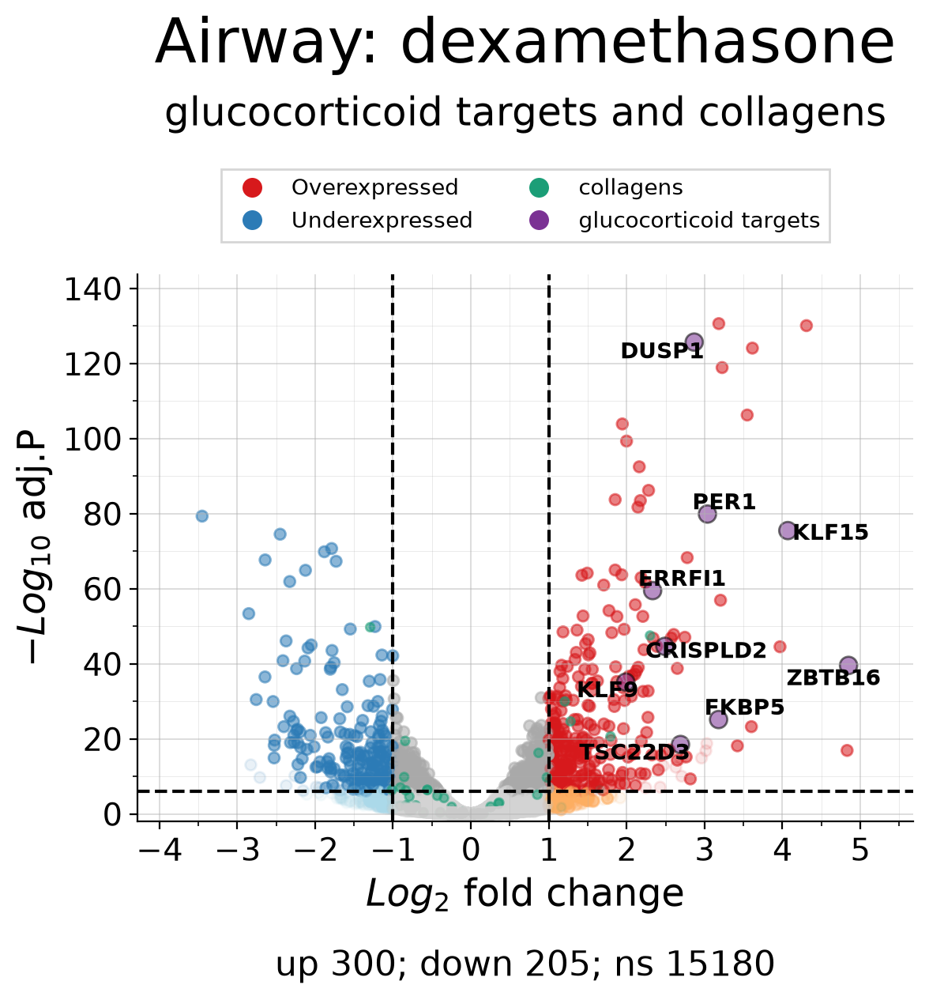

Volcano plots are used in almost every RNA-seq analysis, yet in Python there are few alternatives to writing
custom plotting code each time. easy_volcano draws a clean volcano plot in one line, and lets you customise
every part of it when you need to: colours, labels, legend, extra lines, and any matplotlib option.

## Installation

easy_volcano is not on PyPI yet. Install the latest version from GitHub:

```bash
pip install git+https://github.com/rLannes/easy_volcano.git
```

## Quick start

```python
import pandas as pd
import matplotlib.pyplot as plt
import easy_volcano as ev

df = pd.read_csv("data/easy_volcano_airway_example.tsv", sep="\t")   # a DESeq2 results table
fig, ax = ev.plot_volcano(df)
plt.show()
```

By default easy_volcano uses the DESeq2 column names (`log2FoldChange` and `padj`).
For other tools, pass the column names with `x=` and `y=`, for example `x="logFC", y="adj.P.Val"` for limma.

## Almost endless customisation

Most customisation goes through `highlights`, a list of `(which genes, how to draw them)` pairs:

```python
ev.plot_volcano(df, highlights=[(["FKBP5", "PER1"], {"color": "purple", "size": 200, "label": "my genes"})])
```

- **Which genes**: a list of gene names, a rule such as `lambda d: d["baseMean"] < 100`, or a True/False column.
- **How to draw them**: any option of matplotlib's `scatter` (`color`, `size`, `marker`, `edgecolors`, ...),
  plus `label` to add the group to the legend and `label_gene` to write the gene names on the plot.

See [How highlights work](#how-highlights-work) and [the `{...}` pattern](#the-pattern-options-passed-to-matplotlib)
below for the full explanation.

## Examples

<!-- examples:start -->

All examples use the *airway* RNA-seq dataset (DESeq2 results, the same dataset as the EnhancedVolcano vignette), included in [`data/easy_volcano_airway_example.tsv`](data/easy_volcano_airway_example.tsv). The same code is available as a notebook: [`data/Examples_notebook.ipynb`](data/Examples_notebook.ipynb).

### Contents

1. [Simple plot](#simple-plot)
    - [Load the data](#load-the-data)
    - [Default plot](#default-plot)
2. [Customisation](#customisation)
    - [Legend position, label column and number of labels](#legend-position-label-column-and-number-of-labels)
    - [Thresholds and custom lines](#thresholds-and-custom-lines)
    - [How highlights work](#how-highlights-work)
    - [The `{...}` pattern: options passed to matplotlib](#the-pattern-options-passed-to-matplotlib)
    - [Custom colours with highlights](#custom-colours-with-highlights)
    - [Highlight low expression genes](#highlight-low-expression-genes)
    - [Spotlight](#spotlight)
3. [Going further](#going-further)
    - [Several panels and clipping p-values](#several-panels-and-clipping-p-values)
    - [Master example](#master-example)
    - [Label the genes you care about](#label-the-genes-you-care-about)
    - [Highlight with a rule over any columns](#highlight-with-a-rule-over-any-columns)
    - [Layered highlights: later wins](#layered-highlights-later-wins)
    - [Keep going with matplotlib](#keep-going-with-matplotlib)
    - [Export for Illustrator](#export-for-illustrator)
4. [All options](#all-options)

<a id="simple-plot"></a>

### Simple plot

<a id="load-the-data"></a>

#### Load the data

```python
import easy_volcano as ev
import pandas as pd
import numpy as np
import matplotlib.pyplot as plt

df = pd.read_csv("data/easy_volcano_airway_example.tsv", sep='\t')
df["gene_name"] = df.index
```

<a id="default-plot"></a>

#### Default plot

By default the 5 most over- and under-expressed genes are labelled.
The adjusted p-value cutoff is 1e-2 by default; airway has a very strong signal, so we use 1e-6 here.

```python
(fig, ax) = ev.plot_volcano(df, y_thr=10**(-6), title="airway", subtitle="subtitle")
plt.show()
```

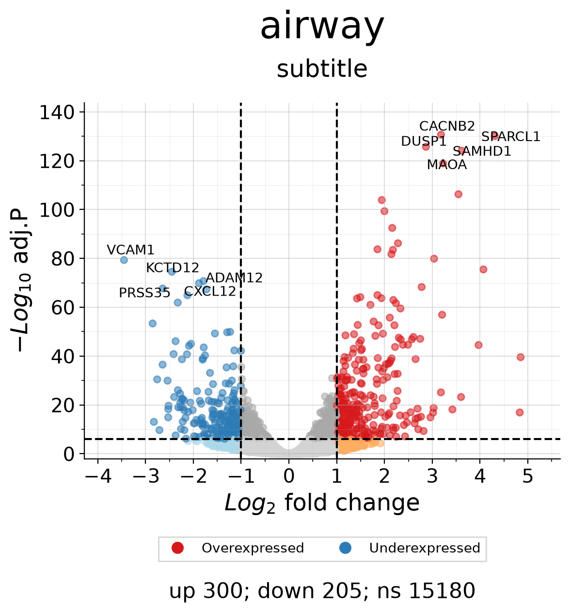

<a id="customisation"></a>

### Customisation

<a id="legend-position-label-column-and-number-of-labels"></a>

#### Legend position, label column and number of labels

- `legend_loc` has three presets: `"top"`, `"bottom"` and `"right"`. More options are available through `legend_kwargs`.
- Labels use the index by default, but any column can be used instead with `label_column="gene_name"`.
- `label_top` labels the top X up- and down-regulated genes.

```python
(fig, ax) = ev.plot_volcano(df, y_thr=10**(-6),  title="airway",
                            subtitle="subtitle", legend_loc='right', width=8, 
                            label_column="gene_name", label_top = 10)
plt.show()
```

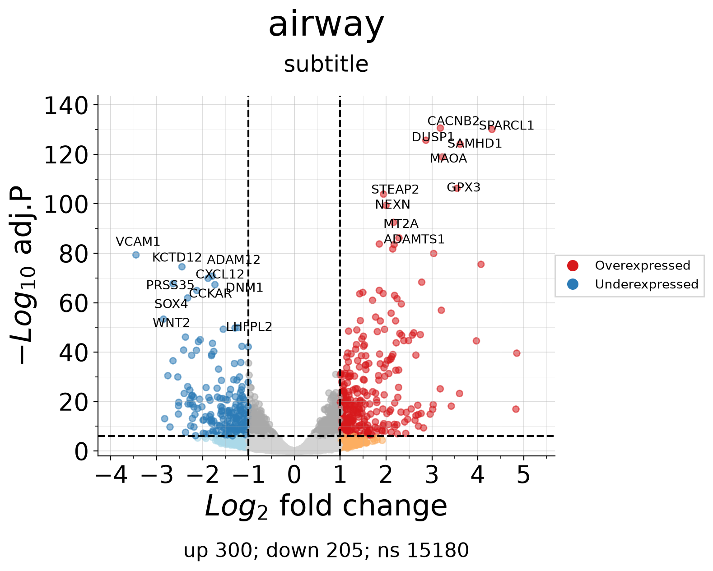

<a id="thresholds-and-custom-lines"></a>

#### Thresholds and custom lines

Changing a threshold moves both the threshold lines and the colours.
You can also add your own horizontal or vertical lines by passing a dictionary, or a list of dictionaries,
with the position (`x` or `y`) plus any matplotlib line option.
For `h_lines`, `y` is a p-value (here `1e-20`, drawn at 20 on the -log10 axis).

```python
(fig, ax) = ev.plot_volcano(df, y_thr=10**(-6),  title="airway",
                            subtitle="subtitle", x_thr=1,
                            h_lines={"y": 10**(-20), "linewidth":5, "color":"red", "linestyle" :"-"},
                            v_lines = [{"x": 2, "color":"pink"},
                                        {"x": -3, "linestyle" : "dotted", "color": "darkgreen"}])
plt.show()
```

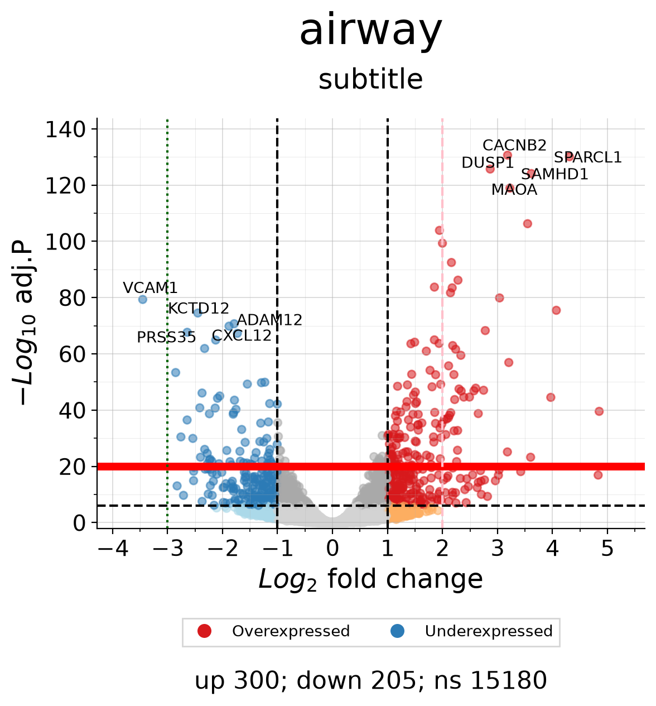

<a id="how-highlights-work"></a>

#### How highlights work

`highlights` is a **list of pairs**. Each pair says *which genes* and *how to draw them*:

```python
highlights=[
    (which_genes, how_to_draw),
    (which_genes, how_to_draw),
]
```

For example, "draw FKBP5 and PER1 in red, bigger":

```python
highlights=[ (["FKBP5", "PER1"], {"color": "red", "size": 200}) ]
#             └─ which genes ──┘  └──────── how to draw ───────┘
```

Three rules to remember:

1. **Pairs are applied in order, and the last one wins.** If a gene is matched by two pairs, the later pair's style is used
   (only for the options it sets; the rest are kept from earlier pairs).
2. **Highlighted genes are drawn on top** of all other points, so they are never hidden.
3. **You only change what you write.** Anything you don't set keeps its default (colour, size, transparency, ...).

##### Which genes: three ways to select

| You write | Meaning | Example |
|---|---|---|
| a list of names | these genes | `["FKBP5", "PER1"]` |
| a rule: `lambda d: ...` | every gene for which the rule is true | `lambda d: d["baseMean"] < 100` |
| a True/False column | the genes marked True | `df["padj"] < 1e-10` |

- **Names** are looked up in the index of your table, or in `label_column` if you set it
  (e.g. `label_column="gene_name"` to use symbols while your index holds Ensembl IDs).
  Even a single gene goes in a list: `["FKBP5"]`, not `"FKBP5"`.
- **A rule** reads as: *"given the table `d`, keep the rows where ..."*. `d` is your table (rows with missing values removed),
  so you can use any of its columns. Combine conditions with `&` (and), `|` (or), `~` (not), with each condition in parentheses:
  `lambda d: (d["baseMean"] > 1000) & (d["log2FoldChange"] > 2)`.
  For text, use pandas string methods: `lambda d: d.index.str.startswith("COL")`.

**Tip: check a rule before plotting.** A rule is just a function, so you can call it on your table
and count how many genes it selects:

```python
rule = lambda d: (d["baseMean"] > 1000) & (d["padj"] < 1e-30)
print(rule(df).sum(), "genes selected")
df[rule(df)].head()
```

Output:

```text
79 genes selected
```

<a id="the-pattern-options-passed-to-matplotlib"></a>

#### The `{...}` pattern: options passed to matplotlib

Many options in easy_volcano are a **dictionary** (`{"name": value, ...}`), for example the *how to draw* part of a highlight,
`label_format`, `legend_kwargs` or each line in `h_lines`. A dictionary is just a bundle of named options.
easy_volcano hands it to the matplotlib function that draws that element, exactly as if you had typed the options yourself:

```python
{"color": "red", "marker": "D", "edgecolors": "black"}
# is passed on as
ax.scatter(..., color="red", marker="D", edgecolors="black")
```

This is why the possibilities are not limited to what easy_volcano lists: **any option the matplotlib function accepts works**.
When you want something new, look up the matplotlib function in the table below, find the option, and put it in the dictionary.

| Option in easy_volcano | Passed to matplotlib's | Useful keys (examples) |
|---|---|---|
| highlight style `(genes, {...})` | [`ax.scatter`](https://matplotlib.org/stable/api/_as_gen/matplotlib.axes.Axes.scatter.html) | `color`, `size`, `alpha`, `marker`, `edgecolors`, `linewidths`, `zorder` |
| any extra keyword, e.g. `plot_volcano(df, edgecolors="none")` | `ax.scatter`, for every point | same as above |
| `label_format`, `label_genes_format`, `label_gene={...}` | [`ax.text`](https://matplotlib.org/stable/api/_as_gen/matplotlib.axes.Axes.text.html) | `fontsize`, `fontweight`, `fontstyle`, `color` |
| `legend_kwargs` | [`ax.legend`](https://matplotlib.org/stable/api/_as_gen/matplotlib.axes.Axes.legend.html) | `fontsize`, `frameon`, `title`, `ncols` |
| each line in `h_lines` / `v_lines` | [`ax.axhline` / `ax.axvline`](https://matplotlib.org/stable/api/_as_gen/matplotlib.axes.Axes.axhline.html) | `color`, `linestyle`, `linewidth`, `alpha` |

A few things easy_volcano adds on top:

- **Short names** in highlight styles: `size` means matplotlib's `s`, `color` means `c`, and `a` means `alpha`.
  Use one form or the other, not both.
- **Extra keys** in highlight styles, handled by easy_volcano and not passed to matplotlib:
  - `"label": "my genes"` adds the group to the legend,
  - `"label_gene": True` writes the gene names on the plot; a dictionary (`{"fontweight": "bold"}`) also styles those names, like `label_format`.
- **Position keys are reserved**: in text formats, `x`, `y`, `s`, `position` and `text` are set by easy_volcano;
  in `h_lines`/`v_lines`, `y`/`x` is the position (for `h_lines`, `y` is a p-value).

<a id="custom-colours-with-highlights"></a>

#### Custom colours with highlights

Select genes with a rule (a `lambda` on the table) or directly with a list of index names.
- Adding a `label` key adds the group to the legend.
- Setting `label_gene` adds the gene names to the plot.

Here shows that ribosomal protein gene are not DE

```python
(fig, ax) = ev.plot_volcano(df, y_thr=10**(-6), width=6, title="airway", subtitle="subtitle", legend_loc='bottom',
                          highlights= [(lambda d: d.index.str.startswith("RPL"),
                                        {"color": "purple", "size": 80, "label": 'ribosomal gene'}), 
                                        (["GPX3", "STEAP2"] , {"color": "green", "label_gene": "True", "label": 'target' })
                                      ]
                           )
plt.show()
```

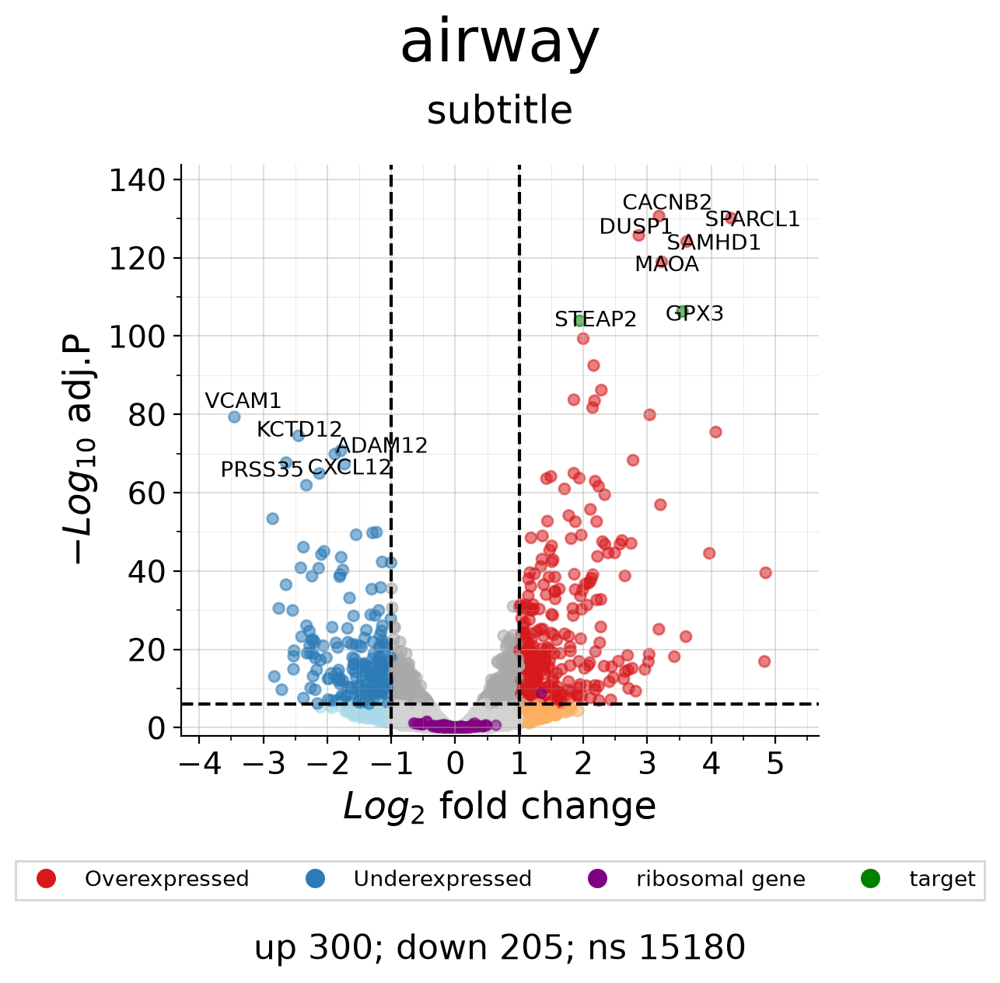

<a id="highlight-low-expression-genes"></a>

#### Highlight low expression genes

A rule can use any column of the table, here `baseMean`.

One could do the opposite and fade/ hide those.

```python
(fig, ax) = ev.plot_volcano(df, y_thr=10**(-6), width=6, title="airway", subtitle="highlight low expression genes", legend_loc='bottom',
                          highlights= [(lambda d: d["baseMean"] < 100, {"alpha": 1, "color":"black", "label": "low expression" })]
                           )
plt.show()
```

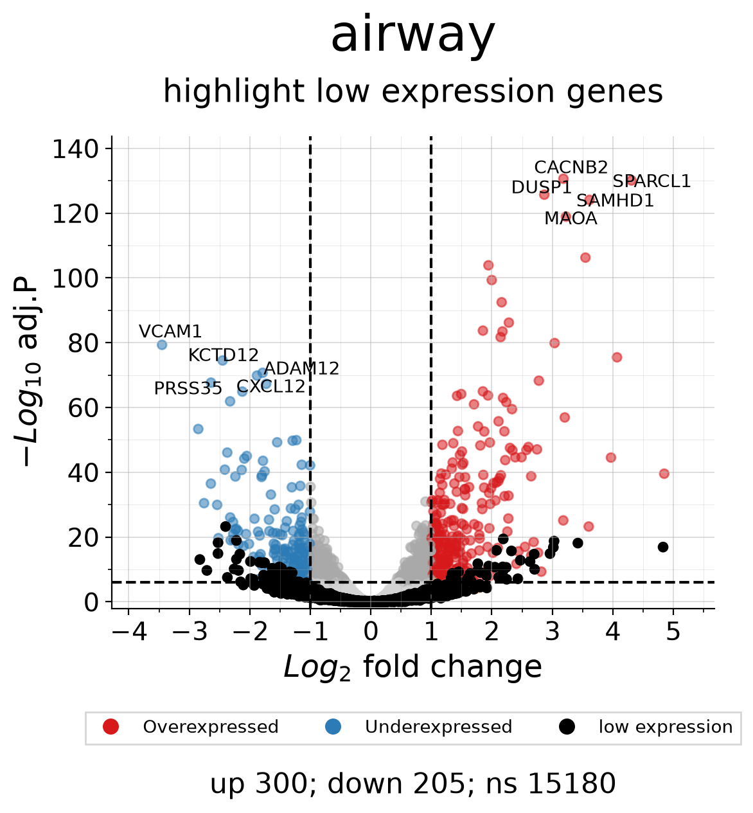

<a id="spotlight"></a>

#### Spotlight

`no_default=True` turns off the default colouring, so only your genes stand out.

```python
(fig, ax) = ev.plot_volcano(df, y_thr=10**(-6), width=6, title="airway", subtitle="spotlight",
                            no_default=True, label_top=None,
                          highlights= [(["GPX3", "STEAP2"] , {"color": "green", "label_gene": "True", "label": 'target' })]
                           )
plt.show()
```

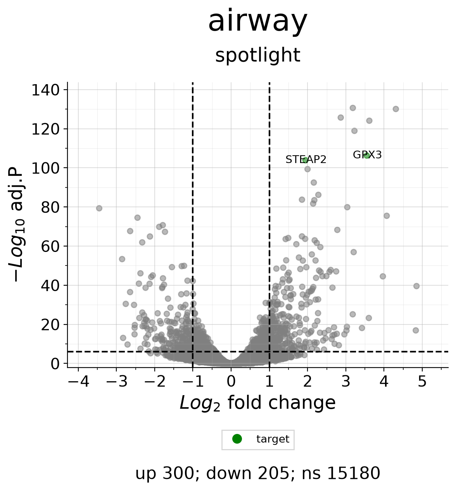

<a id="going-further"></a>

### Going further

<a id="several-panels-and-clipping-p-values"></a>

#### Several panels and clipping p-values

- Pass `ax=` to draw into an existing figure, here two panels side by side.
- `clip_pval` (right) avoids a squashed plot when some p-values are extremely small or zero.

```python
fig, axes = plt.subplots(ncols=2)
(fig, ax) = ev.plot_volcano(df, ax=axes[0], y_thr=10**(-6), width=6, title="airway", subtitle="spotlight",
                            no_default=True, label_top=None, font_size_text_summary=12,
                          highlights= [(["GPX3", "STEAP2"] , {"color": "green", "label_gene": "True", "label": 'target' })]
                           )
(fig, ax) = ev.plot_volcano(df, ax=axes[1], y_thr=10**(-6), width=6, title="airway", subtitle="spotlight",
                            no_default=True, label_top=None, clip_pval=10**(-50),font_size_text_summary=12,
                          highlights= [(["GPX3", "STEAP2"] , {"color": "green", "label_gene": "True", "label": 'target' })]
                           )
plt.show()
```

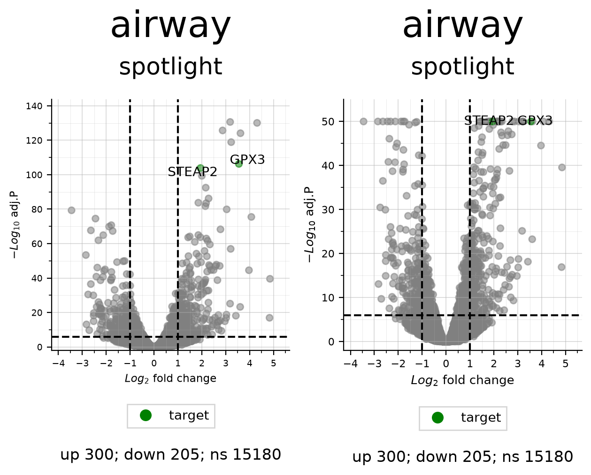

<a id="master-example"></a>

#### Master example 

Airway cells were treated with dexamethasone, a glucocorticoid. In one call:
- lowly expressed genes are faded (a rule on `baseMean`),
- collagens are picked by a rule on the gene name,
- canonical glucocorticoid targets are given as a plain list, drawn bigger with an outline, and labelled in bold,
- title, subtitle and legend are stacked on top without overlapping.

Highlights are applied in order: a gene matched by several layers keeps the last one.

```python
gc_targets = ["FKBP5", "TSC22D3", "PER1", "KLF15", "ZBTB16",
              "DUSP1", "CRISPLD2", "KLF9", "ERRFI1"]

fig, ax = ev.plot_volcano(
    df, y_thr=1e-6, label_top=None, label_avoid_self=True,
    title="Airway: dexamethasone",
    subtitle="glucocorticoid targets and collagens",
    legend_loc="top", legend_nrows=2,
    highlights=[
        # 1. fade lowly expressed genes
        (lambda d: d["baseMean"] < 50, {"alpha": 0.1}),
        # 2. a gene family picked by a rule on the index
        (lambda d: d.index.str.startswith("COL"),
         {"color": "#1b9e77", "size": 60, "label": "collagens"}),
        # 3. a hand-picked list, outlined and labelled in bold
        (gc_targets,
         {"color": "#7b3294", "size": 250, "edgecolors": "black", "linewidths": 1,
          "label": "glucocorticoid targets", "label_gene": {"fontweight": "bold"}}),
    ])
plt.show()
```


<a id="label-the-genes-you-care-about"></a>

#### Label the genes you care about

`label_top` labels the most significant genes on each side; `label_genes` adds your own.
`label_genes_format` styles only your genes (any matplotlib text option), and
`label_genes_line` draws a line from a label to its point when the label had to move.

```python
fig, ax = ev.plot_volcano(
    df, y_thr=1e-6, label_top=3,
    label_genes=["FKBP5", "KLF15", "PER1", "CXCL12"],
    label_genes_format={"fontweight": "bold", "color": "#7b3294"},
    label_genes_line=True, label_min_arrow_len=5,
    subtitle="top 3 per side + your genes, styled")
plt.show()
```

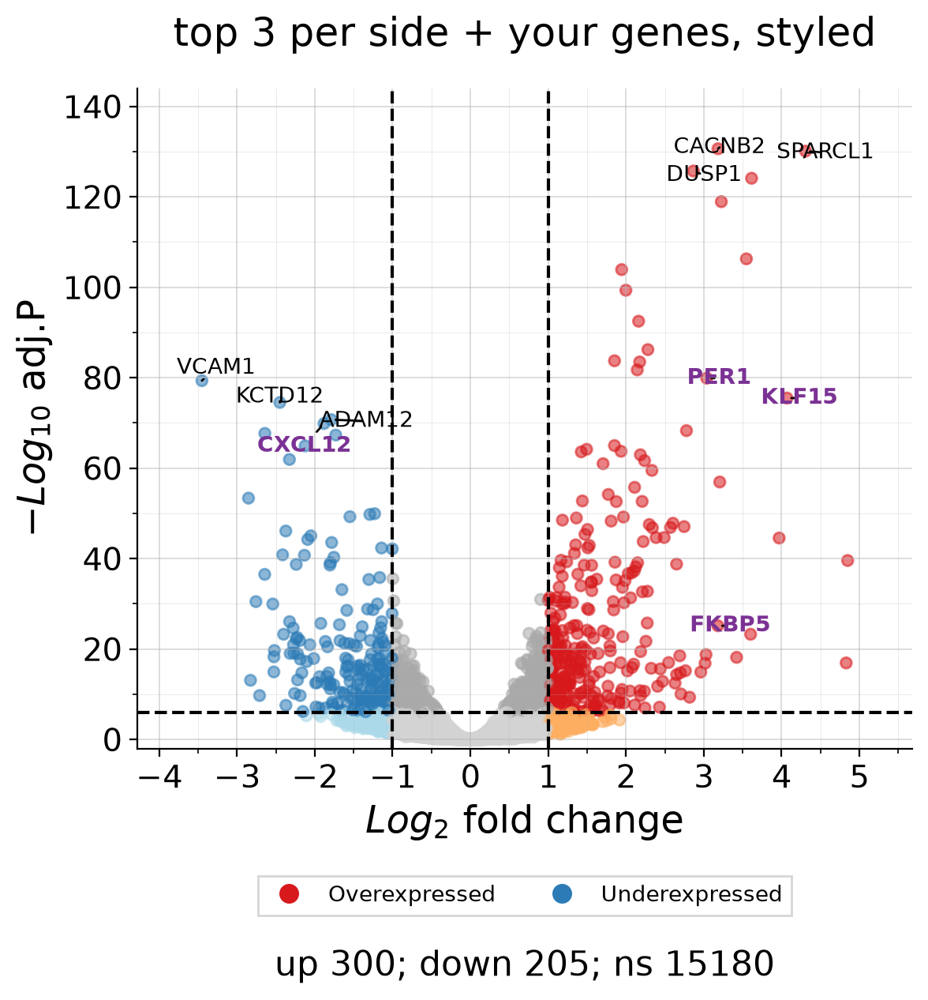

<a id="highlight-with-a-rule-over-any-columns"></a>

#### Highlight with a rule over any columns

A selector can be a function of the table: here, highly expressed **and** very significant genes.
The style dict accepts any `ax.scatter` argument (`marker`, `edgecolors`, `linewidths`, ...).

```python
fig, ax = ev.plot_volcano(
    df, y_thr=1e-6, label_top=None,
    subtitle="rule over several columns", legend_nrows=2,
    highlights=[
        (lambda d: (d["baseMean"] > 1000) & (d["padj"] < 1e-30),
         {"marker": "D", "size": 50, "color": "gold", "edgecolors": "black",
          "label": "baseMean > 1000 and padj < 1e-30"}),
    ])
plt.show()
```

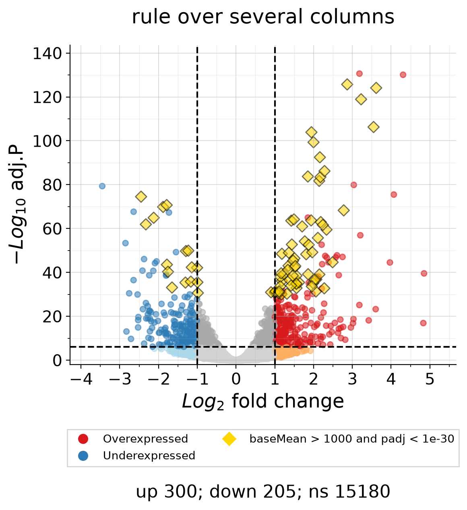

<a id="layered-highlights-later-wins"></a>

#### Layered highlights: later wins

All collagens are green; collagens that also change more than 2-fold are then restyled by a second layer
(darker, bigger, outlined and labelled).

```python
fig, ax = ev.plot_volcano(
    df, y_thr=1e-6, label_top=None,
    subtitle="layered highlights: later wins", legend_nrows=2,
    highlights=[
        (lambda d: d.index.str.startswith("COL"),
         {"color": "#1b9e77", "size": 60, "label": "collagens"}),
        (lambda d: d.index.str.startswith("COL") & (d["log2FoldChange"].abs() > 1),
         {"color": "#0b5d44", "size": 200, "edgecolors": "black",
          "label": "collagens |LFC| > 1", "label_gene": True}),
    ])
plt.show()
```

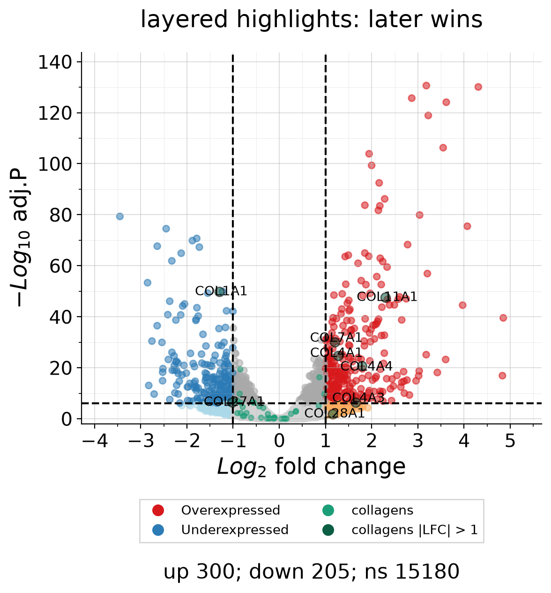

<a id="keep-going-with-matplotlib"></a>

#### Keep going with matplotlib

`plot_volcano` returns `(fig, ax)`, so anything matplotlib can do still works afterwards:
here a shaded region and an annotation with an arrow.

```python
fig, ax = ev.plot_volcano(df, y_thr=1e-6, label_top=None,
                          subtitle="returns (fig, ax): keep going with matplotlib")
xlim = ax.get_xlim()
ax.axvspan(2, xlim[1], color="#D7191C", alpha=0.08, zorder=0)   # shade a region
ax.set_xlim(xlim)                                                # keep the original limits
gene = "ZBTB16"
xy = (df.loc[gene, "log2FoldChange"], -np.log10(df.loc[gene, "padj"]))
ax.annotate(f"{gene}\nstrongest induction", xy=xy, xytext=(xy[0] - 2.5, xy[1] + 40),
            arrowprops=dict(arrowstyle="->"), fontsize=11)
plt.show()
```

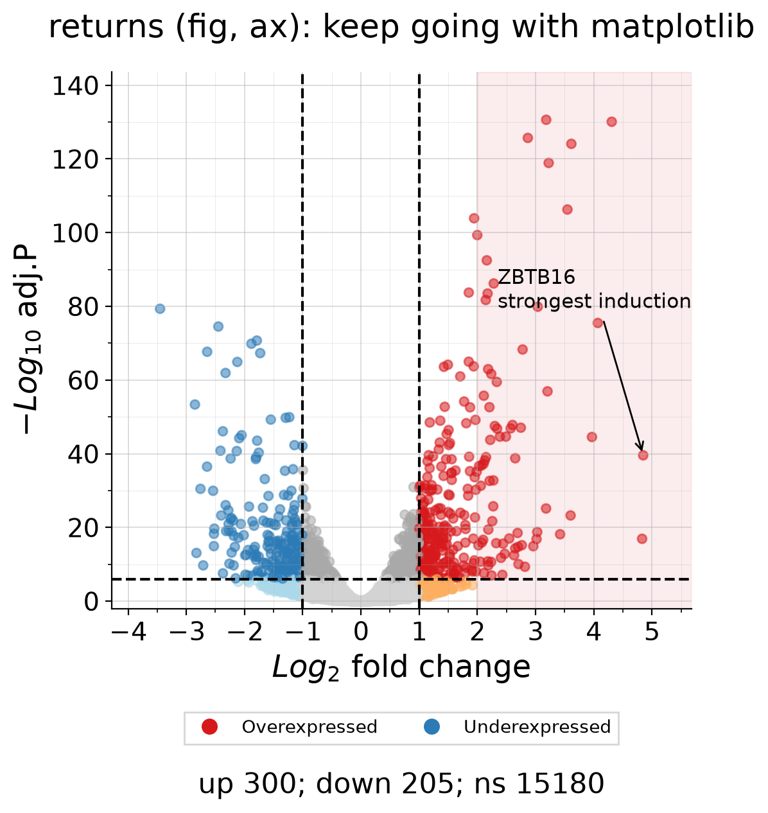

<a id="export-for-illustrator"></a>

#### Export for Illustrator

Text is saved as editable text in PDF. With `rasterize=True` the points become an image while
text, axes and lines stay vector, so the file stays small and still opens quickly in Illustrator.

```python
for raster in (False, True):
    fig, ax = ev.plot_volcano(df, y_thr=1e-6, rasterize=raster, savefig=path)
    plt.close(fig)
    print(f"rasterize={raster}: {path.stat().st_size / 1e3:.0f} kB")
```

Output:

```text
rasterize=False: 2625 kB
rasterize=True: 57 kB
```

<!-- examples:end -->

## Not supported yet

- density plots
- continuous colour scales
- boxed labels

<a id="all-options"></a>

## All options

<!-- options:start -->

All parameters of `plot_volcano`, from its docstring (also available with `help(ev.plot_volcano)`):

```text
Draw a volcano plot from a differential-expression results table.

    Reads a tab-separated results file, computes -log10 of the adjusted
    p-value, and scatters it against the log2 fold change. Points are first
    coloured by the default significance categories, then any user-supplied
    `highlights` are overlaid on top. 
    Rows containing any NA in the required column (lfc and padj) are dropped
    before plotting.

    
        plot_volcano(df,
             y="padj", x="log2FoldChange",
             highlights=[(["kl-3", "kl-5", "kl-2"], {"color": "red", "size":30}),],
             display_grid=True, display_gene_name=["kl-3", "kl-5", "kl-2"])#

             highlights special keyword: 
                - boxes_label : boolean (in future may support dict)
                - label : str -> add str to legend
                - label_gene : None or dict indicate that those genes must have their label set, the dict can take any text formatting option from mpl. 

    Parameters
    ----------
    df : pd.DataFrame
        Rows containing any NA are dropped before plotting.
    color_bg : str, default "white",
    x : str , default "log2FoldChange"
        column used for the X-axis
    y : str , default "padj",
        column used for the Y-axis
    x_thr : float, default 1,
        X-axis threshold used for coloring, summarizing count and plotting lines
    y_thr : float, default 0.01, 
        Y-axis threshold used for coloring, summarizing count and plotting lines
    
    ----------
    ## p-val cap
        By default easy_volcano shrink the Y axis to the smallest value present in df.
        p-value of zeros are transformed to this values (needed for the log transform). 
    clip_pval : float: default None
        if set superseed pval_floor, clip all pvalue smaller than 'clip_pval' to 'clip_pval'
    pval_floor : boolean, default False,
        if set  p-value of zeros are transformed to sys.float_info.min. 
    ----------

    ----------
    ## label
    label_genes = None,
    label_genes_line = False,
    label_top = None, # take int label the top X gene over and under expressed (so *2 labels)
    label_column = None, # inseatd of using the index look into this column for label name # label_genes must be from this columns
    label_format = _LABEL_FORMAT_DEFAULT,
    ----------

    alpha : float, default 1
        Point transparency passed to scatter.
    width, float, default 6
        Figure width in inches.
    height : float, default, 6
        Figure height in inches.

    color_bg : str, default "white"
        Figure background colour.
    label_genes : set of str, default empty
        Index labels to annotate. Labels are repositioned with adjustText to
        reduce overlap.
    label_genes_line : bool
        add a line from gene label to gene
    x : str, default "log2FoldChange"
        Column holding the log2 fold change (x-axis).
    y : str, default "padj"
        Column holding the adjusted p-value (converted to -log10 for the
        y-axis).
    x_thr : float, default 1
        Absolute log2 fold-change threshold used by the default colouring.
    y_thr : float, default 0.01
        Adjusted p-value threshold used by the default colouring (compared on
        the raw p-value, not on -log10).
    display_grid : bool, default True
        Whether to draw major and minor grid lines.
    highlights : list of (selector, override) tuples, default None
        Custom styling layer, drawn on top of everything else. `selector` is
        anything accepted by _resolve (a predicate `lambda d: ...`, a boolean
        Series, or a list of index labels); `override` is a dict of scatter
        keyword arguments, e.g. {"color": "red", "size": 20} 

        d[x] and d[y] refer to the "x" argument and the "y" argument (usualy lfc and pvalue).
        you can also use any coluns present in the dataframe df.
        [(lambda d: (d[y] >= 2) & (abs(d[x]) <= 1), { "color": "blue"})]

        USing a label key work in the override, will add it to the legends
        list selectors match label_column if set, otherwise the index.
s
    color_sig : str, default "#F7DDAA"
        gene that pass the  p-value threshold but not the log folchange threshold.
        (y > y_thr AND abs(x) > x_thr)
    
    color_ns : str, default "lightgrey"
        gene that do not pass any threshold.
        (y < y_thr AND abs(x) < x_thr)

    color_up : str, default "#FDAE61"
        Colour for up-regulated points (y < y_thr and abs(x) > x_thr).

    color_up_sig : str, default "#D77191C"
        Colour for significantly up-regulated points (y > y_thr and abs(x) > x_thr).

    color_down : str, default "#ABD9E9"
        Colour for down-regulated points (y < y_thr and abs(x) < -x_thr).
    
    color_down_sig : str, default "#2C7BB6"
        Colour for significantly down-regulated points (y > y_thr and abs(x) < -x_thr).


    no_default : bool, default False
        If True (or if `x_thr` or `y_thr` is None), skip the default
        significance colouring; all points keep the base `color`.
    size : float, default 5
        Base point size.
    marker: string '.'
     default marker 
    color_base : str, default "grey"
        Base point colour, used before any override. if no default and no highlight all the point will be this color.
    savefig : str or path, optional
        If given, save the figure to this path with bbox_inches="tight".
    ----------
    ## title, legend and summary layout
        Elements around the plot are stacked automatically so they never
        overlap. Above the plot, from the axes up: legend (if
        legend_loc="top"), subtitle, title. Below the plot, from the x-label
        down: legend (if legend_loc="bottom"), text summary.
        All paddings are gaps in points between an element and the one
        before it in the stack, so they do not depend on figure size.

    title : str, default ""
        Plot title. Not drawn if empty.
    title_pad : float, default 15
        Gap (points) between the title and the element below it
        (subtitle, top legend, or the plot).
    title_fontsize : float, default 28
    subtitle : str, default ""
        Text drawn between the title and the plot. Not drawn if empty.
    subtitle_pad : float, default 15
        Gap (points) between the subtitle and the element below it
        (top legend or the plot).
    subtitle_fontsize : float, default 18

    show_legend : bool, default True
        Draw the legend. Same as legend_loc=None when False.
    legend_loc : {"bottom", "top", "right"} or None, default "bottom"
        Legend position preset. None draws no legend.
        Entries come from the default categories ("Overexpressed",
        "Underexpressed") and from any highlight with a "label" key.
        If there are no entries, no legend is drawn.
    legend_nrows : int or None, default None
        Number of legend rows. None means one row for "top"/"bottom" and
        one column for "right". An explicit "ncols" in legend_kwargs wins.
    legend_kwargs : dict or None, default None
        Extra keyword arguments passed to matplotlib's ax.legend, merged on
        top of the preset (e.g. {"fontsize": 12, "frameon": False}).
        Use matplotlib names (bbox_to_anchor, loc, ncols, ...).
    padding_legend : float, default 15
        Gap (points) between the legend and the plot (top) or the x-label
        (bottom). Currently not applied to legend_loc="right".
    legend_fancybox : bool, default True
        Currently unused; pass {"fancybox": ...} in legend_kwargs instead.

    show_text_summary : bool, default True
        Write "up N; down N; ns N" under the plot (needs x_thr and y_thr).
    font_size_text_summary : float, default 16
    padding_text_summary : float, default 15
        Gap (points) between the summary and the element above it
        (bottom legend or the x-label).
    ----------

    return_fig : bool, default False
        return (fig, ax)
    xlabel: str default '$Log_{2}$ fold change',
    ylabel: str '$-Log_{10}$ adj.P'
    custom_ax: if set function will not create a figure but plot in this axes directly not compatible with:
      return fig and savefig. 
    **scatter_kwargs
        Extra keyword arguments forwarded to scatter for every point
        (e.g. marker, linewidths).

    Returns
    -------
    (fig ax)
        The figure is drawn
        optional:
            if savefig is not None and is a vlaid file save the figure
    
```

<!-- options:end -->
